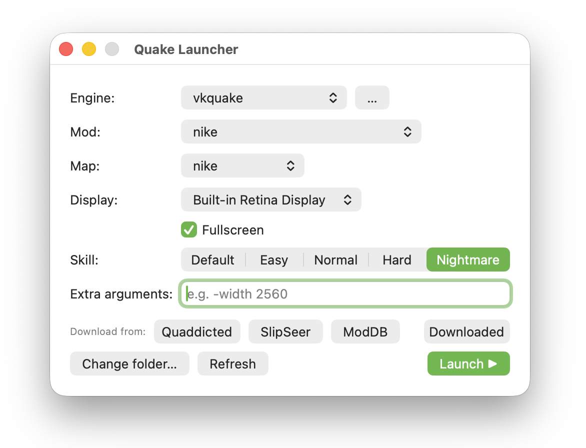
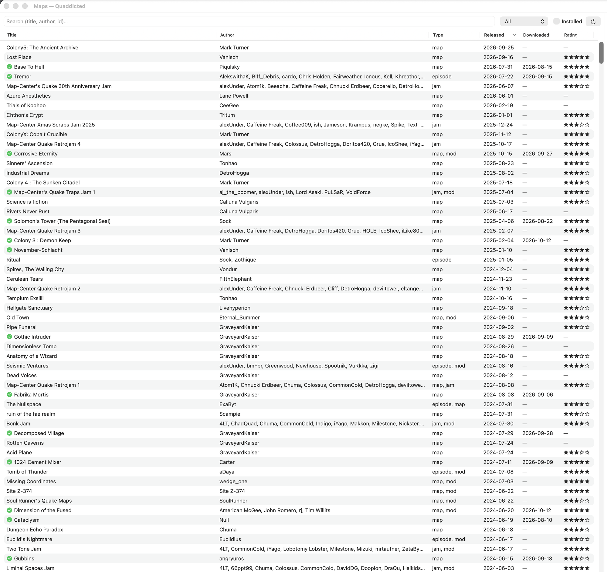
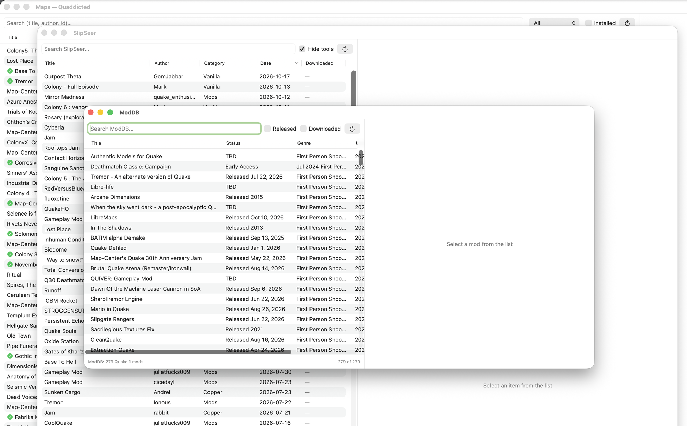

# Quake Tools for macOS

Two small native macOS apps for playing classic Quake (1996) and its community maps:

- **Quake Launcher** — pick an engine, mod, map, skill and display, then play. Browse and
  install single-player maps and mods from [Quaddicted](https://www.quaddicted.com),
  [Slipseer](https://www.slipseer.com) and [ModDB](https://www.moddb.com) in one click.
- **Quake Config** — a visual editor for `autoexec.cfg`: common options, player name and
  colours, and key bindings on an on-screen keyboard.

Written in SwiftUI, no dependencies, builds with the Command Line Tools alone (no Xcode project).

<p align="center"></p>





## Features

**Launcher**
- Detects installed engines (QuakeSpasm, vkQuake, Ironwail, DarkPlaces, FTE…) in
  `/Applications` and `~/Applications`; any other engine can be added by hand.
- Lists mods (game directories) and their maps, with a spoiler-free “map contents” panel
  (monsters, secrets, items) read straight from the `.bsp`, also from inside `.pak` files.
- Launches the game on a chosen display (see [Display selection](#display-selection)).
- Fullscreen / windowed, skill and extra command-line arguments.

**Map and mod browser**
- Quaddicted: the full map database with ratings, tags and screenshots; resolves required base
  mods (Quoth, Copper, Arcane Dimensions…) and starts maps with the right `-game`.
- Slipseer and ModDB: browse, download and install.
- A shared library of everything downloaded, from all sources, with install date.
- Extracts ZIP, TAR and GZIP out of the box; RAR and 7z need `unar` (see below).

**Config editor**
- Edits `<mod>/autoexec.cfg`, keeping lines it doesn't know about.
- Previews text in the Quake console font.

## Requirements

- macOS 15 (Sequoia) or newer, Apple Silicon or Intel.
- A Quake engine, e.g. [QuakeSpasm](https://quakespasm.sourceforge.net),
  [vkQuake](https://github.com/Novum/vkQuake) or [Ironwail](https://github.com/andrei-drexler/ironwail).
- **Your own copy of Quake.** The apps don't include any game data. You need `id1/pak0.pak`
  and `id1/pak1.pak` from a retail copy (Steam, GOG, the 2021 re-release…). On first launch
  you point the launcher at the folder that contains `id1`.
- Optional: `unar` for RAR/7z archives — `brew install unar`.
- To build: Xcode Command Line Tools (`xcode-select --install`).

## Install

Download `QuakeTools.dmg` from [Releases](../../releases) and drag both apps to Applications.

## Build from source

```sh
./build.sh          # builds and signs QuakeLauncher.app and QuakeConfig.app
./build.sh dist     # also builds QuakeTools.dmg
```

`build.sh` signs with the first *Developer ID Application* or *Apple Development* identity in
your keychain, or ad-hoc if there is none. Override with `SIGN_ID="…" ./build.sh`.
With a Developer ID and a `notarytool` keychain profile (`NOTARY_PROFILE`, default
`quaketools`), `dist` also notarizes and staples the DMG.

Ad-hoc builds run fine on the machine that built them. Copied to another Mac they are blocked
by Gatekeeper: right-click → Open, or `xattr -dr com.apple.quarantine QuakeLauncher.app`.

### Layout

```
Sources/QuakeLauncher/   launcher app (Launcher, Quaddicted, Slipseer, ModDB, Library, Maps)
Sources/QuakeConfig/     config editor app
Sources/DisplayShim/     dylib injected into the engine to pick the display
Resources/<App>/         Info.plist, icon and its source artwork
Tools/                   icon and DMG background generators
```

## Known limitations

### Display selection

Engines built on SDL open fullscreen on the main display and have no option to change it.
To launch on another display, the launcher injects a tiny library (`libdisplayshim.dylib`)
through `DYLD_INSERT_LIBRARIES` that moves the SDL window onto the chosen screen. It supports
SDL2 (QuakeSpasm, Ironwail) and SDL3 (vkQuake).

- macOS ignores `DYLD_INSERT_LIBRARIES` for apps signed with the **hardened runtime** (most
  notarized apps). For such engines the display choice has no effect and the game starts on
  the main display; everything else works.
- The official QuakeSpasm build for macOS is Intel-only and runs under **Rosetta 2**. The shim
  is built universal (arm64 + x86_64) for this reason. Install Rosetta if macOS asks for it.

### ModDB

ModDB has no public API and sits behind Cloudflare, so the ModDB browser reads its HTML pages.
When Cloudflare responds with a challenge, the launcher shows the page in a built-in WebKit
view (the same engine as Safari). You may need to click the check yourself; the cookies are
then reused for downloads. Expect this part to break whenever ModDB or Cloudflare change
something. Quaddicted (official API) and Slipseer (plain HTML) are not affected.

Please be gentle with these community sites: lists are cached locally and pages are fetched
only when you open them.

## Data and settings

- Downloaded maps and mods are installed into your Quake folder; the library index is
  `<Quake folder>/.quakelauncher-library.json`.
- Site listings are cached in `~/Library/Caches/com.marcinkleczek.quakelauncher/`.
- Settings live in the standard user defaults (`com.marcinkleczek.quakelauncher`,
  `com.marcinkleczek.quakeconfig`).

## License

[MIT](LICENSE).

Quake is a trademark of id Software / ZeniMax Media. This project is not affiliated with or
endorsed by id Software, Bethesda or ZeniMax. The app icons are original artwork.
